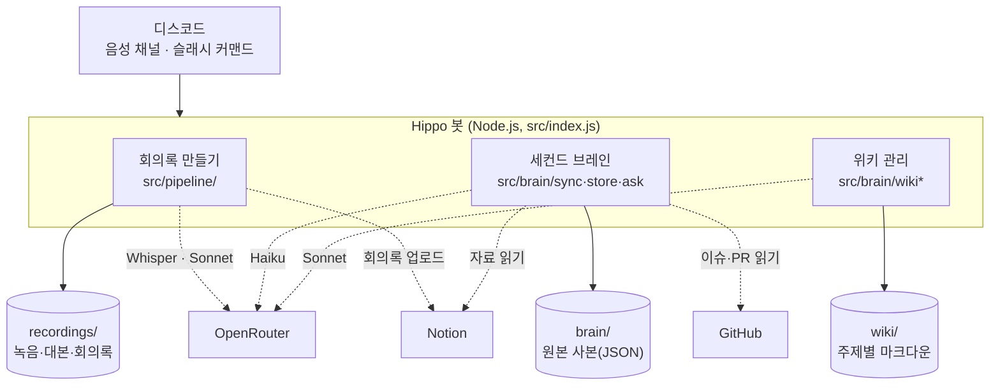

# moamap-secretary (Hippo 🦛)

모아맵 팀의 디스코드 비서 봇입니다. 디스코드 회의를 녹음해 회의록을 노션에 올리고, 노션·GitHub·회의 내용을 모아 둔 "세컨드 브레인"으로 팀의 질문에 답합니다.

## 왜 만들었나

- 회의는 디스코드 음성 채널에서 하는데, 회의록은 누군가 손으로 정리해야 했습니다.
- 자료가 노션(기획·디자인·QA·서버 문서), GitHub(이슈·PR 5개 저장소), 회의에 흩어져 있어서 "그거 어떻게 하기로 했지?", "그 이슈 머지됐어?"를 알려면 여러 곳을 뒤져야 했습니다.
- 자료끼리 내용이 어긋나는 일(회의 결정과 구현이 다름, 옛 문서가 남아 있음)이 많았습니다.

Hippo는 회의록 작성을 자동으로 하고, 흩어진 자료를 한곳에서 찾아 출처와 함께 답하며, 어긋나는 내용을 위키에 모아 팀에 알립니다.

## 할 수 있는 것

| 커맨드 / 작업 | 하는 일 |
|---|---|
| `/회의시작` | 지금 있는 음성 채널에 들어가 사람별로 녹음 |
| `/회의종료` | 음성 인식 → 회의록 작성 → 노션 📍 Moamap Planner에 업로드 → 디스코드에 요약 카드(결정 사항·할 일 멘션) |
| `/물어보기 질문` | 위키와 원본 자료를 찾아 읽고 출처 링크와 함께 답변 |
| 1시간마다 | 노션·GitHub·회의 대본을 다시 모음(바뀐 것만) |
| 하루 1번 | 바뀐 자료를 위키의 관련 페이지에 반영 |
| 주 1번 | 위키를 점검해 모순·오래된 정보·팀이 정할 것을 디스코드 채널에 보고 |

## 아키텍처

이 컴퓨터(또는 상시 켜 둔 서버)에서 도는 Node.js 프로그램 하나입니다. 데이터베이스 없이 폴더 세 개에 파일로 저장합니다.



### 1. 회의록 만들기

```
/회의시작 → 녹음 → /회의종료 → STT → 요약 → 노션 업로드 → 디스코드 요약 카드
```

1. **녹음** (`src/recorder.js`): 사람별 음성을 받아 1초 동안 말이 없으면 한 발화로 끊어 WAV로 저장합니다(1초 미만은 "네"·잡음이 대부분이라 버림).
2. **STT** (`src/pipeline/transcribe.js`): OpenRouter의 Whisper large v3로 발화 2개씩 동시에 전사합니다(더 늘리면 OpenRouter가 429로 막습니다). Whisper가 지어내는 상투 문구를 걸러내고, `members.json`의 실명으로 바꿔 시간순 대본을 만듭니다.
3. **요약** (`src/pipeline/summarize.js`): Claude Sonnet 5.5가 대본을 정해진 JSON(요약·결정 사항·할 일·보류·안건·파트별 진행)으로 정리합니다. 실패하면 Haiku 5.5로 넘어갑니다.
4. **업로드** (`src/pipeline/notion-publish.js`): Planner에 "N차 회의 (Hippo 작성)" 페이지를 새로 만듭니다. 사람이 쓴 회의록과는 섞지 않습니다.

단계마다 결과 파일(`transcript.md`, `minutes.json`)이 남아서, 중간에 실패하면 그 단계부터 다시 이어서 할 수 있습니다.

### 2. 세컨드 브레인

```
노션 · GitHub · 회의 대본 ──(1시간마다 동기화)──▶ brain/ ──▶ /물어보기
```

- **동기화** (`src/brain/sync*.js`): 노션 팀 홈 아래 모든 페이지·DB(행 안의 하위 페이지까지), Moa-Map 조직의 이슈·PR·댓글, 회의 대본을 JSON으로 복사합니다. 바뀐 것만 다시 가져옵니다.
- **민감 정보 차단** (`src/brain/store.js`): 제목에 민감 단어(계정, 회계, API 키 등)가 들어간 노션 페이지는 통째로 빼고, 본문의 비밀번호·키·토큰처럼 보이는 줄은 저장 전에 지웁니다.
- **검색** (`src/brain/store.js`): BM25 키워드 검색. 한국어는 한 글자·두 글자 단위로 쪼개 조사가 붙어도 찾고, 최근 문서에 가산점을 줍니다.
- **답변** (`src/brain/ask.js`): Haiku 5.5가 도구를 쓰며 근거를 모아 답합니다(최대 8번 왕복).
  1. 위키 목차를 보고 관련 페이지를 읽음
  2. 부족하거나 최신 현황(열림·닫힘, 머지 여부)이 필요하면 원본을 검색·읽기
  3. 이슈·PR 목록과 전체 개수를 조회

### 3. 위키 (LLM Wiki 패턴)

Andrej Karpathy가 제안한 LLM Wiki 패턴을 팀 봇에 맞게 바꿨습니다. 질문할 때마다 원본 전체를 뒤지는 대신, LLM이 정리해 둔 위키를 계속 고쳐 가며 씁니다.

| 개념 | Hippo |
|---|---|
| 원본(raw) | `brain/` — 노션·GitHub·회의 대본 사본 |
| 위키 | `wiki/` — 기능별·기술·팀·사업 페이지, 결정 로그(`decisions.md`), 충돌·확인 필요 목록(`conflicts.md`) |
| 규칙(schema) | `wiki/WIKI.md` — 출처 링크 필수, 상태 표시(✅🚧📝❌), 바뀐 결정은 이력으로 남기기, 민감 정보 금지 |
| Ingest | `src/brain/wiki-update.js` — 바뀐 원본을 대기 목록(`brain/wiki-state.json`)에 쌓았다가 하루 1번 Sonnet이 관련 페이지만 고침 |
| Query | `/물어보기` — 위키 먼저, 부족하면 원본 |
| Lint | `src/brain/wiki-lint.js` — 주 1번 점검 결과를 디스코드에 보고(위키를 직접 고치지는 않음) |

안전장치: 자동 갱신은 규칙 파일을 고칠 수 없고, 기존 페이지보다 지나치게 짧게 다시 쓰면 저장을 거부합니다. 처음 위키는 API 없이 Claude Code로 직접 작성했습니다.

### 모델과 비용

| 작업 | 모델 | 비용 (2026-10-23 측정) |
|---|---|---|
| 음성 인식 | Whisper large v3 | 회의 길이에 비례 |
| 회의록 요약 | Claude Sonnet 5.5 → 실패 시 Haiku 5.5 | 대본 길이에 비례 |
| `/물어보기` | Claude Haiku 5.5 + 프롬프트 캐싱 | 질문당 약 $0.0025 (Sonnet이면 약 $0.07) |
| 위키 자동 갱신 | Claude Sonnet 5.5 | 바뀐 문서 양에 비례 |
| 위키 주간 점검 | Claude Sonnet 5.5 | 1번에 약 $0.19 |

모든 모델은 [OpenRouter](https://openrouter.ai)로 호출하고, `.env`의 `STT_MODEL`, `SUMMARY_MODELS`, `BRAIN_MODEL`로 바꿀 수 있습니다.

## 준비

1. [Discord Developer Portal](https://discord.com/developers/applications)에서 앱과 봇을 만들고 토큰을 발급합니다.
   - OAuth2 URL Generator: scope `bot`, `applications.commands` / 권한 `Connect`, `Speak`, `Send Messages`
2. 노션 워크스페이스 소유자가 [노션 통합](https://www.notion.so/profile/integrations)을 만들고(내부 통합, 콘텐츠 읽기·업데이트·입력 + 사용자 정보 읽기), 팀 페이지에서 ··· → 연결 → 통합을 추가합니다.
3. `.env.example`을 `.env`로 복사하고 값을 채웁니다. 팀원 노션 ID는 `members.json`의 `notionId`에 넣습니다.
4. 의존성 설치, 슬래시 커맨드 등록, 실행:

```bash
npm install
```

```bash
npm run deploy-commands
```

```bash
npm start
```

## 노션 회의록

📍 Moamap Planner에 항상 "N차 회의 (Hippo 작성)" 항목을 새로 만듭니다. 사람이 쓰는 회의록 페이지는 건드리지 않습니다. 차수는 같은 날짜에 사람이 쓴 "회의" 항목이 있으면 그 차수를 따르고, 없으면 지금까지 가장 큰 차수의 다음 번호를 씁니다. 태그(회의+비대면), 날짜, 참석자는 자동으로 채웁니다.
본문은 📌 요약 → ✅ 결정 사항 → 📝 할 일(체크박스, 담당자 멘션·기한) → ⏳ 다음 논의 내용이 펼쳐져 있고, 안건별 논의와 파트별 진행 상황은 토글로 접혀 있습니다.

## 세컨드 브레인 (/물어보기)

봇이 켜질 때와 1시간마다 아래 자료를 `brain/`에 모읍니다(바뀐 것만 다시 가져옴).

- 노션: `NOTION_ROOT_PAGE_ID` 아래 모든 페이지·DB 행. 제목에 `BRAIN_NOTION_EXCLUDE` 단어가 들어간 페이지는 하위까지 제외하고, 본문의 비밀번호·키·토큰 줄은 저장 전에 지웁니다.
- GitHub: `GITHUB_ORG` 조직 모든 저장소의 이슈·PR과 댓글
- 회의 대본: `recordings/*/transcript.md`

`/물어보기`를 받으면 Claude가 검색 → 문서 읽기를 반복해 근거를 모은 뒤 출처 링크와 함께 답합니다. 터미널에서도 확인할 수 있습니다.

```bash
npm run brain-sync
```

```bash
npm run ask -- "카테고리 칩 몇 개로 정했어?"
```

### 위키 운영

- `/물어보기`는 위키 목차를 보고 관련 페이지를 먼저 읽고, 부족하거나 최신 현황이 필요하면 원본을 검색합니다.
- 동기화 때 바뀐 원본은 `brain/wiki-state.json`에 쌓아 두고, `WIKI_UPDATE_HOURS`(기본 24시간)마다 요약 모델(Sonnet)이 관련 페이지만 고칩니다.
- `WIKI_REPORT_CHANNEL_ID`를 넣으면 주 1회 위키를 점검해(모순, 오래된 정보, 팀이 결정할 것) 그 채널에 올립니다.

```bash
npm run wiki-update   # 쌓인 변경분을 지금 반영
npm run wiki-lint     # 점검 결과를 터미널에 출력(디스코드에는 안 올림)
```

## 회의록에 실명 쓰기

`members.example.json`을 `members.json`으로 복사하고, 디스코드 사용자 ID별로 실명을 적습니다. 목록에 없거나 `name`이 비어 있으면 디스코드 닉네임을 그대로 씁니다. 사용자 ID는 디스코드 개발자 모드에서 사람을 우클릭 → "사용자 ID 복사"로 얻을 수 있습니다. `notionId`가 있으면 노션에서 멘션·담당자로 지정됩니다.

## 회의록 다시 만들기

STT·요약·업로드 중 하나가 실패해도 녹음은 남아 있습니다. 단계별 결과(`transcript.md`, `minutes.json`)가 저장되므로, 다시 실행하면 실패한 단계부터 이어서 진행합니다.

```bash
npm run process -- recordings/<회의ID>
```

## 코드 구조

| 파일 | 역할 |
|---|---|
| `src/index.js` | 봇 본체, 슬래시 커맨드 처리 |
| `src/recorder.js` | 음성 수신 → Opus 디코딩 → 발화 단위 WAV 저장 |
| `src/openrouter.js` | OpenRouter 클라이언트 (OpenAI SDK 사용) |
| `src/notion.js` | 노션 API 호출 |
| `src/members.js` | 팀원 실명·역할·노션 ID (`members.json`) |
| `src/pipeline/transcribe.js` | 발화 WAV들을 시간순으로 전사해 대본 생성 |
| `src/pipeline/summarize.js` | 대본 → 구조화된 회의록(JSON) |
| `src/pipeline/notion-publish.js` | Planner에 회의 항목·회의록 본문 생성 |
| `src/summary-embed.js` | 디스코드 요약 카드·답변 카드 |
| `src/brain/sync*.js` | 노션·GitHub·회의 대본 동기화 (`brain/`) |
| `src/brain/store.js` | 문서 저장, 민감 정보 제거, 키워드 검색(BM25) |
| `src/brain/ask.js` | 위키 먼저 읽고 검색·읽기 도구로 답하는 질문 답변 |
| `src/brain/wiki.js` | 위키 페이지 읽기·쓰기, 반영 대기 상태 |
| `src/brain/wiki-update.js` | 바뀐 원본을 관련 위키 페이지에 반영 |
| `src/brain/wiki-lint.js` | 주간 위키 점검 보고 |
| `test/` | 단위 테스트 (`npm test`, `src/`와 같은 경로에 `*.test.js`) |

## 참고

- 음성 채널 E2EE(DAVE)는 `@discordjs/voice`가 기본으로 처리합니다(`@snazzah/davey` 포함).
- 봇 음성 수신은 디스코드가 공식 지원하는 기능이 아니라서, 디스코드 업데이트 후 동작이 깨질 수 있습니다.
- 음성 연결이 계속 유지돼야 하므로 서버리스가 아닌 상시 실행 서버에 띄워야 합니다.
